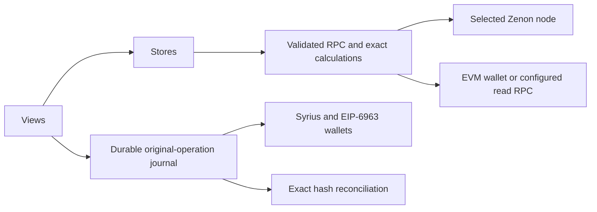
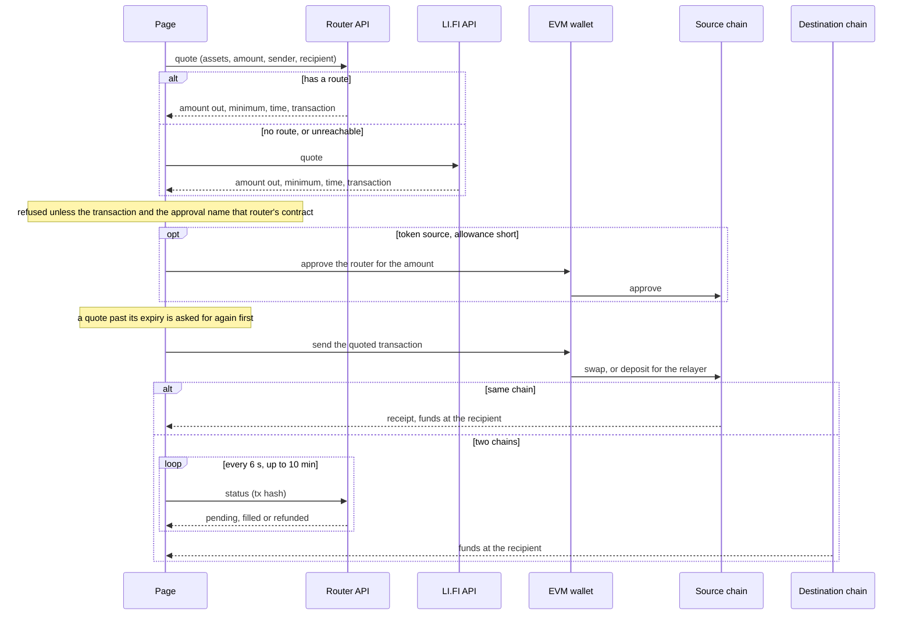

# Architecture

The static Vue application reads Zenon JSON-RPC and EVM contracts. Wallets sign and publish transactions; the application never stores private keys. Core calculations, RPC validation, context ownership, durable operation evidence and views are separate modules.

## Read ownership

Node epochs and API ownership distinguish a retired connection from the active one. A subscribed momentum can contain only hash/height; its full timestamp and chain identity are fetched and validated before committing. Disconnect cancels RPC waiters, HTTP requests, polling and reconnection. A call has one whole twenty-second deadline.

Routes use network class, EVM chain, bridge contract, Zenon token standard and EVM token address as their identity. Configuration and health reads commit atomically only for their captured context. Missing EVM metadata, chain identity, halted contracts, key or decimal mismatches close the route. Unknown or stale health closes new sends; an explicit degraded-service override cannot override missing configuration or identity.

| Read | Scope and bound |
|---|---|
| Node frontier | Correct chain, no more than 120 seconds old or 60 seconds ahead |
| Bridge configuration and health | Captured node context; safety lifetime 180 seconds |
| Address history | Stable count, up to 100 pages of 100 records; four reads per history family |
| Network/token metadata | Two network tasks and two token tasks per network |
| Redeem state | Current reader chain, exact ID, fresh EVM head; unread state is unavailable |
| Health observation | At most 100 unsigned requests and 300 recent bridge blocks; sample bounds visible |
| Pool/stake data | Captured account/provider/node/program identity; fresh read before signing |

Changing nodes, chains, accounts or providers invalidates current action readiness. An old response cannot populate a new scope. Failed history reads retain dated rows with an explicit error. Known unresolved operations are reconciled independently of address-history availability. Amounts use integer arithmetic; ambiguous comma separators and excess precision are refused.

## Publication ownership

The chosen source chain, account, contract, amount, recipient, referral and calldata are captured before awaiting approval. Form controls stay frozen during the operation. Source and economic configuration are checked again before every wallet prompt, including a prompt delayed by the Syrius exclusive queue.

`bridge.operations.v1` is saved and read back before wallet invocation. Secure-context Web Locks serialize publication across tabs. Missing lock support or unreadable storage prevents signing. An unresolved journal record blocks a second operation for the same source/account/chain after reload or tab closure. Other-tab records are merged without discarding original hashes.

Only the original promise or the exact original hash can resolve an unknown outcome. Zenon recovery verifies chosen fields, computed hash, signature, public key/account and confirmation. EVM recovery verifies the original transaction, receipt, canonical block, reader chain and two confirmations. These reads trust the chosen RPC; they are not a light-client finality proof. A mismatch requires independent review. No replacement, nonce discovery or fuzzy history search is performed.

## Actions and completion

| Action | Publication | Completion check |
|---|---|---|
| Wrap | Zenon `WrapToken` | Exact request, signature and later EVM redeem steps |
| Redeem wrap | EVM `redeem`, twice with delay | Successful original receipt and expected `redeemsInfo` step |
| Unwrap | EVM approval then `unwrap` | Allowance, successful original receipt, exact transaction/log request |
| Redeem unwrap | Zenon `Redeem` | Submission shown separately from later request state |
| Add liquidity | EVM approval then router call | Allowance, successful original receipt and increased LP balance |
| Stake/cancel/collect | Zenon liquidity calls | Submission shown separately; fresh program/expiry/reward state |

New stakes are paused when rewards are zero. A successful source transaction does not establish opposite-chain completion, TSS availability or irreversible finality. The one-key lab models messages and contract calls; production ceremonies and integration acceptance remain separate.

## Browser and deployment

Views and reconciliation load lazily. Fonts, scripts and icons are local. Hash routes support static hosting. Navigation adapts below desktop width; nested dialogs own focus/Escape, make the background inert and restore focus/scroll. Reduced-motion preferences are honored.

The HTML declares CSP/referrer policy; the legacy affiliate landing page accepts only same-origin destinations without userinfo. Framing and transport headers require hosting-owner configuration. See [deployment gates](DEPLOY.md), [recovery](RECOVERY.md), [testing](TESTING.md), [support](SUPPORT.md) and [provenance](PROVENANCE.md).

## Swaps

An EVM asset can go to another EVM asset, on the same chain or on the other
one, without the bridge: ETH to wZNN, wZNN on Ethereum to BNB, and so on. The
assets are each chain's coin and the bridge's own tokens there, less pool
shares. `src/core/swap.ts` asks a router for one transaction and the wallet
sends it. Three routers, each answering a browser with no key:

| Swap | Router | Why |
|---|---|---|
| One chain | KyberSwap's aggregator | Takes no fee. For wZNN it returns exactly what the Uniswap V2 pool pays |
| Two chains | Across | Relayers fill in seconds, and it paid the most on every pair tried |
| Either, as a fallback | LI.FI | Reaches the most tokens, and takes 0.25% for it. Asked only when the first has no route |

Measured on 2026-10-13, amount received, against LI.FI alone (the first
version of this feature):

| Pair | LI.FI | Now | Gain |
|---|---|---|---|
| 0.1 ETH to wZNN, Ethereum | 1564.857 wZNN | 1568.755 wZNN, KyberSwap | 0.25% |
| 1000 wZNN to ETH, Ethereum | 0.062577 ETH | 0.062733 ETH, KyberSwap | 0.25% |
| 0.1 ETH to BNB | 0.332674 BNB | 0.335430 BNB, Across | 0.83% |
| 0.3 BNB to ETH | 0.089149 ETH | 0.089303 ETH, Across | 0.17% |
| 1000 wZNN, Ethereum, to BNB | 0.208523 BNB | 0.210411 BNB, Across | 0.91% |

Also tried and set aside: Relay (0.1% better than LI.FI on one chain, 11% worse
on wZNN across two), Symbiosis and deBridge (within 0.03% of Relay on ETH to
BNB, and deBridge adds a fixed 0.001 ETH), 1inch (its API needs a key and
refuses browsers), and a direct Uniswap router call (one pool on one chain;
KyberSwap gives the same price and covers the other tokens).

Router API is KyberSwap on one chain and Across on two. Each router's contract
is one address on both chains, held in `src/config.ts`. A quote is refused
unless its transaction and its approval name the contract of the router that
answered, and its value is the amount entered for a coin and zero for a token.
A quote refused that way is shown; it is not replaced by another router's.
Approvals are for the amount, not unlimited.

A toggle above the form, Bridge or Swap, picks which of the two the page
does; Bridge is the default. In Bridge the pickers offer only a Zenon token
and its EVM counterpart. In Swap they offer only EVM assets. Each mode comes
back to the pair it last showed. The mode is shared state
(`src/state/swap.ts`) because the banners follow it: in Swap the bridge-down
banner is hidden, and on entering Swap the page asks each router something
cheap (`checkRouters`: a KyberSwap route, Across's route list, LI.FI's chain
list, none of them a quote). If neither kind of swap has a router that
answers, or only one kind has, a banner says so. A pair with no route reads
"No route found" on the button.

What changes on the page for a swap: Syrius is not asked for, the bridge's
terms are not asked for, the time shown is the quote's (seconds, not the
bridge's half hour), the recipient is an EVM address and can still be a custom
one, the bridge-down block does not apply, and the details list the route, the
minimum received and the fee in dollars.

Limits. The quote is asked for when an input settles, not on a timer: the
routers are unkeyed and rate limited (LI.FI allows 75 quotes per two hours).
An Across quote is good for about half a minute, so it is usually asked for
again on send; a worse one is shown before anything is signed. KyberSwap
refuses a few well-known addresses, anvil's first account among them, and such
a sender falls back to LI.FI. A swap is not a bridge request, so Activity does
not list it: it is followed with toasts in the tab that sent it, and a reload
loses that.

## Prices

Both amounts carry a dollar estimate, and the details list each token's price.
`fetchPrice` in `src/core/swap.ts` reads LI.FI's token list (`/token`, 100
lookups a minute unkeyed), kept for five minutes per token. A Zenon token is
priced by the EVM token the bridge pairs it with: ZNN by wZNN. A token LI.FI
does not list shows no estimate. Nothing is quoted, limited or sent by these
numbers.

## Router qualification boundary

The price comparisons above are dated upstream observations, not a new qualification result. Router calldata and cross-chain status remain external-service assertions. A source transaction receipt alone does not establish delivery on the receiving chain. The original-operation journal and receipt validation apply to swap approvals and sends; real router, wallet and destination outcomes require separate acceptance.
