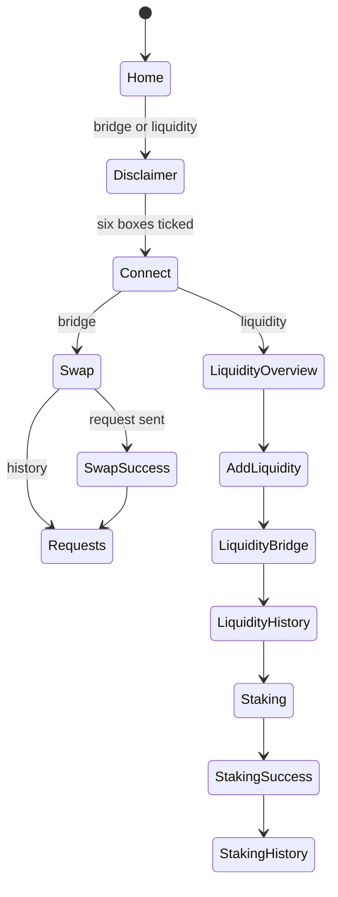
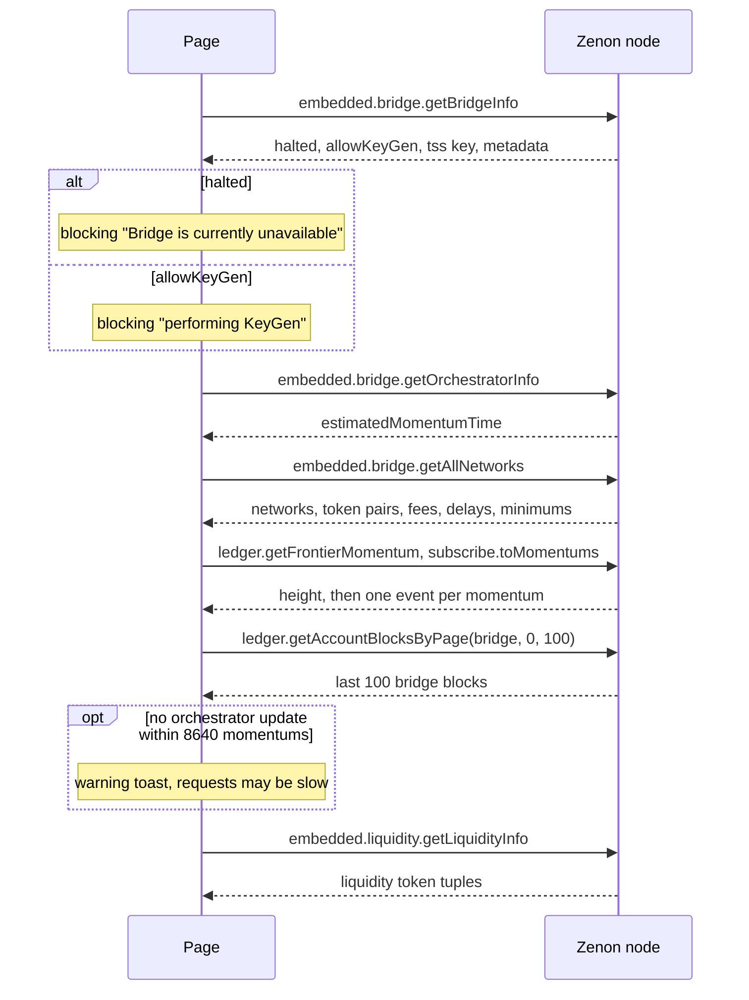
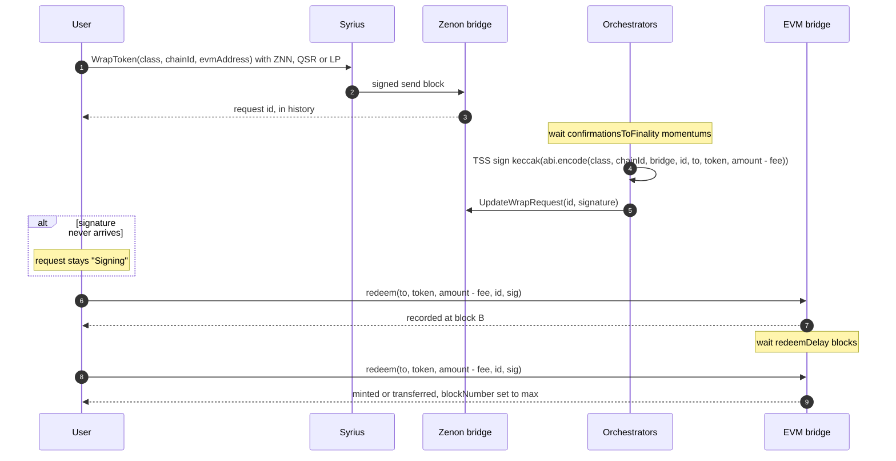
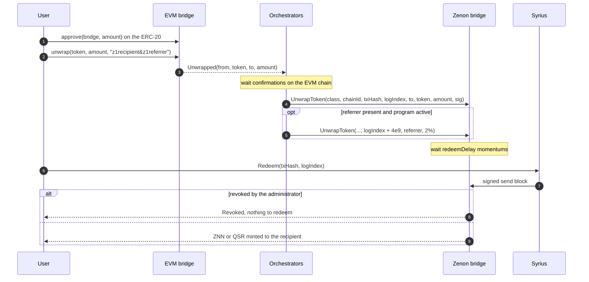
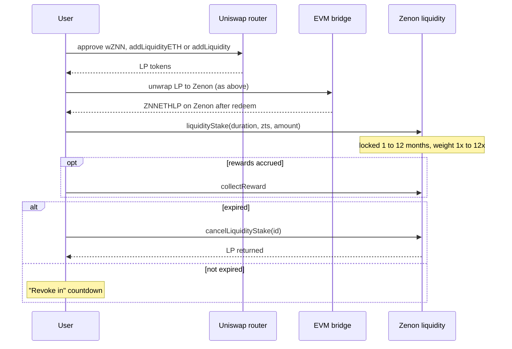

# What the original bridge front end did

This documents the app that was deployed at `bridge.mainnet.zenon.community` up to commit
`e2b7c6b` ("Mainnet release"). The repository held only a Create React App production build; the
source was recovered from the build's source maps (`static/js/main.*.js.map`, `sourcesContent`).
Paths below are relative to that recovered `src/`.

This is a historical inventory, not current release or integration evidence. Source pairing and ownership must be established as described in [PROVENANCE.md](PROVENANCE.md). Current publication guards, recovery and supported integration limits are in [ARCHITECTURE.md](ARCHITECTURE.md), [RECOVERY.md](RECOVERY.md) and [SUPPORT.md](SUPPORT.md). The historical **Rebuild:** notes do not qualify a real wallet, DEX or production service.

## Stack

| Concern | Original |
|---|---|
| Framework | CRA, React 18, react-router (one route `/`) |
| State | Redux Toolkit (`services/redux/*`), persisted pieces in `localStorage` |
| Forms, toasts | react-hook-form, react-toastify |
| Zenon | `znn-ts-sdk` over WebSocket |
| EVM | ethers 5 |
| Remote wallets | WalletConnect v2 sign client and modal |
| Analytics | Google Tag Manager `GTM-TC768WT`, Twitter pixel `o3khw` |

`REACT_APP_NETWORK_ENV` picks a constants set (`utils/constants.tsx`): `production` and `staging`
(mainnet, Zenon chain 1, Ethereum 1), `test` and `development` (Zenon chain 3, Sepolia 11155111,
`wss://syrius-testnet.zenon.community`), and `supernova-*` (a planned EVM chain "Supernova" with
native XZNN, using `unwrapNative` and `redeemNative`; its chain id came from env and was 0 in the
mainnet build).

**Rebuild:** Vue 3, Vite, viem, no SDK. `VITE_NETWORK=mainnet|devnet`. Supernova is not carried
over: it was never deployed and its chain id was unset.

## Navigation

A wizard, not pages. `wizardStatus` in redux holds the step; every step renders inside
`layouts/wizardLayout`.

Swap steps are numbered 0 to 5, liquidity steps 11 to 19. Outside an iframe, a `beforeunload`
handler asks before leaving.

The disclaimer (`services/redux/agreementItemsSlice.tsx`) requires six boxes:

1. I understand all the risks involved with cryptocurrency and I did my due diligence.
2. I understand this is an experimental tool and it comes as is, with no guarantees.
3. I will not use this tool for any illegal activity.
4. I am not an entity or citizen of the US nor any OFAC sanctioned country, nor am I at the moment
   living nor visiting any of the OFAC sanctioned countries.
5. I will not send funds from a custodial wallet nor attempt to send them directly to the contract.
6. I understand using this tool can result in permanent loss of funds.

**Rebuild:** hash routes (`#/`, `#/activity`, `#/liquidity`, `#/stats`, `#/affiliate`), since
GitHub Pages has no SPA fallback. The six terms are one acknowledgement, kept until cleared.

## Zenon wallet

Two transports, chosen on the Connect step.

**Syrius browser extension** (`services/hooks/internalNetwork-provider/syriusExtensionWrapper.tsx`).
Detected by `window.zenon.isSyriusExtension`. All calls go over `window.postMessage`:

| Page sends | Extension replies |
|---|---|
| `znn.requestWalletAccess` | `znn.grantedWalletRead {address, chainId, nodeUrl}` or `znn.deniedWalletRead` |
| `znn.sendAccountBlockToSend {accountBlock}` | `znn.accountBlockSent {signedTransaction}` or `znn.deniedSendAccountBlock` |

The extension also pushes `znn.addressChanged`, `znn.chainIdChanged` and `znn.nodeChanged`.

**Syrius desktop over WalletConnect** (`internalNetworkWalletConnectWrapper.tsx`), namespace
`zenon:1`, methods `znn_info`, `znn_sign`, `znn_send`. Calls retry up to three times on
WalletConnect errors.

The page opens its own SDK socket to the node the wallet reports. A node of `embedded` or one on
`127.0.0.1` cannot be reached from a web page, so it is replaced by
`wss://syrius-mainnet.zenon.community` with a toast.

**Rebuild:** Syrius extension only. Both its APIs are handled: the postMessage one above and the
v0.3.4+ one (`window.zenon.connect`, `getAccounts`, `getChainId`, `getNodeUrl`, `sendAccountBlock`).
A request within 30 s of a declined window returns `-32005` with no window; the adapter waits and
retries. WalletConnect is dropped: it needs a project id and a remote relay.

## EVM wallet

MetaMask only (`window.ethereum.isMetaMask`, otherwise a link to the Chrome store), or
WalletConnect. Calls used: `eth_requestAccounts`, `wallet_switchEthereumChain`,
`wallet_watchAsset`. Events: `accountsChanged` (an empty list means disconnect), `chainChanged`.

**Rebuild:** any injected wallet found by EIP-6963 (MetaMask, Rabby, Phantom, Coinbase, others),
with `window.ethereum` as a fallback. All EVM reads go through the connected wallet's EIP-1193
provider, so the page uses the user's own RPC.

## On connect

- Token pairs come from `getAllNetworks`: fee `feePercentage / 10000`, `redeemDelay` in momentums,
  `minAmount`. Display metadata (logo, symbol) came from a hardcoded token list, which showed BNB
  Chain as testnet chain 97 while mainnet has BNB Chain 56. **Rebuild:** networks and tokens come
  entirely from `getAllNetworks`, with symbols from `embedded.token.getByZts` and the ERC-20.
- Bridge health (`utils/utils.tsx` `checkIfBridgeCanProcessRequests`): among the bridge's last 100
  account blocks, a paired send whose data starts `1LsRw` (base64 of `UpdateWrapRequest`'s selector
  `d4bb11c0`) or `tgaUAQ` (`UnwrapToken`, `b6069401`) less than 8640 momentums old means the
  orchestrators are active.
- The momentum height is shown in the header and flashes on each new momentum.

## Wrap: Zenon to EVM

- Step 1 is `embedded.bridge.wrapToken(networkClass, chainId, evmAddress, amount, zts)`: a send to
  `z1qxemdeddedxdrydgexxxxxxxxxxxxxxxmqgr0d` carrying the token and amount, data
  `WrapToken(uint32,uint32,string)`.
- Fee shown is `amount × feePercentage / 10000`. Under 75000 plasma a hint suggests fusing QSR
  (`utils/utils.tsx` `hasLowPlasma`).
- The request is stored in `localStorage.wrapRequests` (JSON with bigints) so it shows before the
  node indexes it. History is `embedded.bridge.getAllWrapTokenRequestsByToAddress(evmAddress, page,
  10)`, polled.
- Steps 6 to 9 are two EVM transactions from the same `redeem` call. The signature stored on Zenon
  is base64; its last byte gets 27 added to make `v`.
- Status (`models/wrapRequestItem.tsx`), read from EVM `redeemsInfo(id)`:

| Condition | Status |
|---|---|
| No signature on Zenon | Signing |
| `redeemsInfo.blockNumber == 0` | Redeem (step 1 of 2) |
| `0 < blockNumber < max` | WaitingDelay, countdown `redeemDelay × estimatedBlockTime` |
| `blockNumber == uint256 max` | Redeemed 2/2 |
| `redeem` reverts `not redeemable yet` | WaitingDelay |
| reverts `nonce already redeemed` | Redeemed 2/2 |
| reverts `invalid signature length` or `wrong signature` | Broken |

## Unwrap: EVM to Zenon

- History: `embedded.bridge.getAllUnwrapTokenRequestsByToAddress(z1, page, 10)`. Status from
  `signature`, `redeemableIn` (momentums), `redeemed`, `revoked`: Signing, WaitingConfirmation,
  Redeem, Redeemed, Revoked, Broken.
- A `logIndex ≥ 4000000000` marks an affiliate bonus entry.
- The amount shown is decoded from the EVM transaction's `unwrap` input.
- Stored in `localStorage.unwrapRequests`.

## Affiliate

- A link is `?referral=<code>`, where the code is the referrer's z1 address XORed byte by byte with
  the key `UjFpyVLBUHC` and hex encoded (`utils/mangling.tsx`).
- `components/referralCodeInterpreter` reads it on load. The first referral wins: if
  `localStorage["znn-referral-code"]` already holds one, a new link is ignored.
- `public/affiliate.html` stores the raw `?referral=` value into the same key and redirects to
  `?originURL=`.
- On unwrap, `&<referral>` is appended to the recipient string. The orchestrator
  (`network/evm.go`, HyperCore orchestrator) splits on `&`, parses the second part as a z1
  address, and when bridge metadata `affiliateProgram` covers that network and token from its
  `startingHeight`, pays the unwrapper 101% and the referrer 2% as a second request.
- `stats.getExtraData().affiliate` could supply a referrer from a custom node; standard nodes do
  not have the method.

**Bug kept out of the rebuild:** on the first visit redux held the mangled hex and that was
appended; after a reload it held the decoded address. The orchestrator only accepts an address, so
a fresh referral earned nothing. The rebuild always appends the decoded address.

## Liquidity

Uniswap V2 pair wZNN/WETH `0xdac866A3796F85Cb84A914d98fAeC052E3b5596D`, router
`0x7a250d5630B4cF539739dF2C5dAcb4c659F2488D`.

- Add: slippage field, deadline latest block time + 90 s, gas estimated before sending.
- LP tokens on Zenon: ZNNETHLP `zts17d6yr02kh0r9qr566p7tg6`, QSRETHLP `zts1akfzw3s3h6ytwm07x9mldh`.
- Stake durations: 1 to 12 months of 2592000 s.
- History `embedded.liquidity.getLiquidityStakeEntriesByAddress`; statuses Pending, Revoke in,
  Revoke, Revoked. Rewards `getUncollectedReward`, `collectReward()`.
- Stored in `localStorage.stakeEntries`.
- `disableAddingLiquidity` existed but was never set: the router's `liquidityLimit()` was not read.
- On mainnet (2026-10-12) `getLiquidityInfo` lists one tuple (ZNNETHLP, min 1) and both rewards are
  0: the program is dormant. The flow is kept.

## Storage keys

| Key | Holds |
|---|---|
| `wrapRequests` | Wrap requests sent from this browser |
| `unwrapRequests` | Unwrap requests sent from this browser |
| `stakeEntries` | Liquidity stakes sent from this browser |
| `znn-referral-code` | Mangled referrer address |
| `wc@2:*`, `WCM_RECENT_WALLET_DATA`, `walletConnectPairingsByNamespaces` | WalletConnect sessions |

Bugs kept out of the rebuild: `addCurrentUnwrapRequestToList` wrote unwrap requests into
`wrapRequests`; `WrapRequestItem.toJson` wrote the timestamp into `transactionHash`; the slices
wrote a `stakingEntries` key nobody read.

## Constants (mainnet)

| Name | Value |
|---|---|
| Zenon bridge | `z1qxemdeddedxdrydgexxxxxxxxxxxxxxxmqgr0d` |
| Zenon liquidity | `z1qxemdeddedxlyquydytyxxxxxxxxxxxxflaaae` |
| wZNN (Ethereum) | `0xb2e96a63479C2Edd2FD62b382c89D5CA79f572d3` |
| wQSR (Ethereum, 8 decimals) | `0x96546afe4a21515a3a30cd3fd64a70eb478dc174` |
| Default node | `wss://syrius-mainnet.zenon.community` |
| Explorers | etherscan.io, bscscan.com, zenonhub.io `/explorer/transaction/` |
| Fee denominator | 10000 |
| Affiliate log index offset | 4000000000 |
| Low plasma | 75000 |
| Orchestrator silence warning | 8640 momentums |

Read from mainnet on 2026-10-12: Ethereum bridge `0xa98706106f7710d743186031be2245f33acea106`,
BNB Chain bridge `0x7293e3ff2f1b5a1e1222a427166e8e83605beccf`, ZNN and QSR fee 300/10000, minimum
1 ZNN, `redeemDelay` 90 momentums, `confirmationsToFinality` 90, `estimatedMomentumTime` 10.

## Dropped in the rebuild

| Feature | Why |
|---|---|
| WalletConnect (both sides) | Needs a project id and a remote relay |
| GTM, Twitter pixel | Remote scripts |
| Supernova constants | Never deployed |
| Custom cursor | Not a bridge feature |
