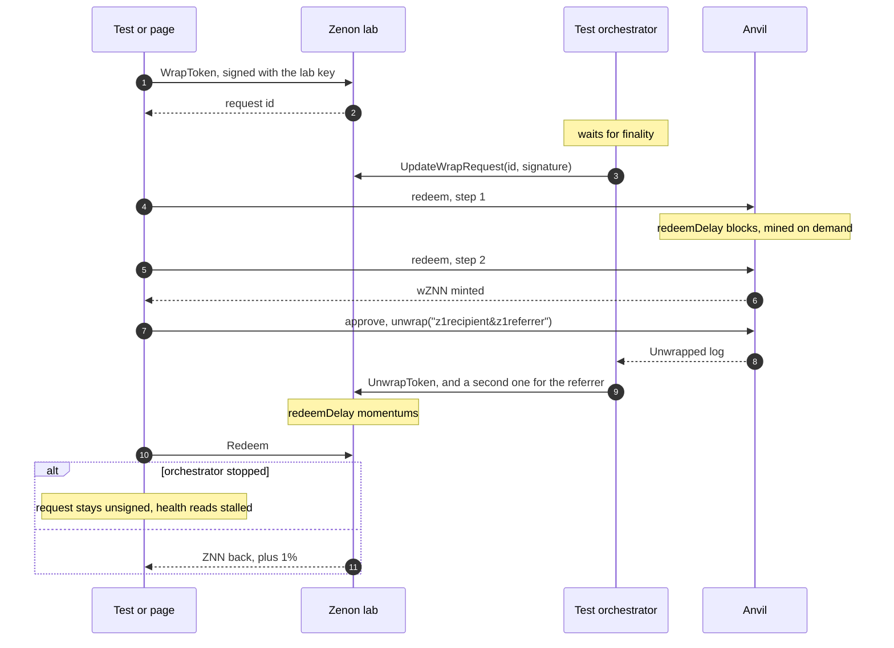

# Testing

Install the committed dependency graph with `npm ci`. Use a supported Node release from `package.json`; CI targets Node 22, 24 and 26. Local qualification and hosted results are separate.

```sh
npm run lint
npm run typecheck
npm run test:coverage
npm audit --audit-level=low
npm run build
CHROME_PATH=<pinned-headless-shell> npm run test:browser
```

## Unit tests

`tests/unit/`, Vitest, no live network. They hold fixtures read from mainnet, so
the encodings are checked against what the chain accepted rather than against
themselves.

| File | Checks |
|---|---|
| `abi.test.ts` | Method ids equal the selectors on the mainnet bridge chain; `WrapToken` and `Redeem` call data byte for byte equal to mainnet blocks; liquidity calls |
| `signatures.test.ts` | A wrap signed by the mainnet orchestrators recovers to the bridge's TSS key through the app's message layout and `evmSignature` |
| `referral.test.ts` | Codes equal the original app's; first referral wins; the unwrap suffix is the decoded address |
| `core.test.ts` | Fees (against a real mainnet wrap), formatting, wrap and unwrap status, revert reasons, affiliate metadata, the plasma bot call, big-integer JSON |
| `swap.test.ts` | Each router's request and the reading of its answer (shapes recorded 2026-10-13); a quote naming any contract but that router's, or another amount, is refused and not shopped elsewhere; KyberSwap on one chain, Across on two, LI.FI as the fallback; router availability; transfer status, time, prices |
| `errors.test.ts` | Thrown errors as shown: viem's wallet rejection text becomes "Declined in wallet", wallet states name the remedy, a revert shows the contract's reason, anything else is one line of 80 characters |
| `orchestrators.test.ts` | The health verdict: halted, key generation, stalled (mainnet as read on 2026-10-12), delayed, online, idle |
| `validation.test.ts` | RPC schema bounds, exact identities and malformed/oversized values |
| `rpc.test.ts` | HTTP/WebSocket lifecycle, paired responses, deadlines and disposal |
| `safety.test.ts` | Context ownership, hard configuration guards, health override and economic rechecks |
| `operations.test.ts` | Durable original intent/hash, cross-tab locks, retention and unknown outcomes |
| `publication-error.test.ts` | Wrapped wallet refusals and ambiguous/errors-with-hashes remain distinct |
| `hashless-recovery.test.ts` | Explicit delayed review, repeated-intent refusal and persistent unknown evidence |
| `reconcile.test.ts` | Original Zenon signature/fields and canonical EVM transaction/receipt evidence |
| `lab-orchestrator.test.ts` | Exact original retries, shutdown ownership and canonical log identity |
| `lab-publication.test.ts` | Receive source ownership and confirmed acknowledgement depth |
| `lab-journal.test.ts` | Archived definite pre-publication rejections; transport/internal/unknown failures stay pending |
| `readiness.test.ts` | Cold-start minimum height and five-node exact recent hash/chain agreement |
| `compile.test.ts` | Source/compiler/import/settings cache identity |
| `state.test.ts` | Retired node/account scopes, atomic refresh and bounded histories |
| `swap-fork.test.ts` | Owned loopback fork preflight, paired RPC responses and refusal before writes |
| `notices.test.ts` | Exact dependency/font attribution bytes, deterministic manifests, substitution/link/path refusal and preservation of existing output |
| `wallet-adapters.test.ts` | Serialized Syrius prompts, explicit cooldown-only retries, original response ownership, legacy timeout/rejection and event disposal |
| `evm-wallet.test.ts` | EIP-6963 discovery, chain/account changes, late initial replies, network switching and silent reconnect ownership |
| `evm-transactions.test.ts` | Original EVM submission/receipt orchestration, reader/hash/reorg/revert failures and retained uncertain outcomes |
| `zenon-session.test.ts` | Selected-node probes, wallet-node consent and restoration, late sessions, original publications and unbiased momentum timing samples |
| `frontier-cli.test.ts` | Actual CLI exit/report behavior with fixture-only transport: cold startup, original-frontier progress, stalled/divergent nodes and malformed identities |

## Deterministic source checks

`tests/unit` covers recorded ABI/signature vectors, exact fees/amounts, recipient/referral eligibility, complete bounded history, schema/RPC failure handling, retired node/account responses, fail-closed route/health authority, journal persistence and original-outcome recovery, EVM receipt identity, compiler-cache inputs and retry-safe lab publications. Fixtures contain public test accounts; no wallet or production write is used.

Coverage includes wallet adapters, EVM clients/transaction orchestration, node,
wallet, bridge and activity state, original-operation recovery, RPC boundaries and
the notice generator. Global thresholds remain 80% lines/functions/statements and
70% branches. Additional higher thresholds protect wallet adapters and EVM
transaction orchestration; the Zenon session has its own threshold. The selected
scope is explicit in `vite.config.ts`, and does not mean every UI file is measured.
Browser focus has separate real-browser qualification. A percentage is not a
security proof.

Controlled local qualification can set `QUALIFICATION_CACHE_DIR`,
`QUALIFICATION_COVERAGE_DIR` and `QUALIFICATION_ENV_DIR` to owned temporary storage.
The latter prevents loading private dotenv files during that qualification. Normal
development retains Vite's configured/default environment behavior.

The journal retention regression creates and rejects 205 entries through the durable APIs. It has a twenty-second test budget because coverage instrumentation on shared CI runners can exceed the default five seconds. Its record-count and unresolved-operation assertions remain required.

## Offline browser qualification

`tests/browser` mounts the actual Vue components and uses isolated providers. Outbound network requests are refused; the disconnected-wallet fallback is served by a loopback fixture. It checks all five views at 320/375/768/1024/1440 pixels in light/dark themes with connected/disconnected wallets, modal keyboard/focus behavior, the continuously animated chain indicator even with OS animation effects disabled, strict amount/recipient checks, late original results, queued economic changes, reverted receipts, same-origin redirects and real cross-tab Web Locks.

Hashless recovery checks distinguish explicit review from resolution: no timer-only
unlock, no repeated encoded request or refreshed equivalent swap, durable unknown
evidence, later original-hash adoption, storage failures and another tab's active
wallet lock. Health opt-in checks retain hard configuration, halt, route, TSS and
node authority.

Liquidity cases cover unavailable/substituted pools, reverted approvals, LP completion postconditions, zero/halted/unavailable programs, source changes before a queued stake, complete paginated stake history, expiry cancellation and submitted-only collection. These fixtures do not establish DEX contract behavior, real LP minting, stake economics or a production reward cycle. Results and screenshots are written to ignored `.browser-results`.

Browser launch keeps Chromium's default sandbox. On Ubuntu 24.04, the qualification workflow loads a root-owned AppArmor profile granting user namespaces to the exact pinned headless-shell executable and retains that profile with its evidence artifact. A browser launch failure fails qualification. Local Linux environments may need the corresponding [Chromium namespace configuration](https://chromium.googlesource.com/chromium/src/+/main/docs/security/apparmor-userns-restrictions.md).

## Isolated protocol and page checks

The compiled-build suite also verifies that every locked non-development package
has its exact notice text and digest in `third-party-notices/`, including the local
fonts. The sanitized compiled report records package/file counts and the notice
manifest digest. Programmatic production builds must exercise this packaging step
as well as the normal CLI build; a missing notice fails qualification.

The isolated bridge lifecycle remains:



### The lab (`e2e/lab/`)

`lab.sh` builds and runs it with Docker. It follows the syrius-extension lab:
its own compose project, containers, subnet, ports and chain identifier, so it
shares nothing with another devnet on the machine.

| | |
|---|---|
| Zenon | go-zenon's five-node devnet, chain 322, RPC on `127.0.0.1:46997` (HTTP) and `46998` (WS) |
| EVM | anvil, chain 31337, on `127.0.0.1:46545`, a fresh chain every start |
| Image | `bridge-lab-znnd:<commit>-<build key>` |

A stock go-zenon devnet cannot run the bridge, for two reasons, and the lab
changes exactly those:

1. The `bridge-liq` spork is off in the devnet genesis. `make-assets.mjs` turns
   it on from genesis, as `az` and `htlc` already are.
2. The bridge administrator is an address compiled into znnd, and its time
   challenges last one and two days. `znnd/devnet_bridge.go` is added to the
   build: when `ZNN_DEVNET_BRIDGE=1` it takes the administrator from
   `ZNN_BRIDGE_ADMIN` and shortens the delays to one and two momentums. This
   is what go-zenon's own bridge tests do in process. The file is not part of
   go-zenon and does nothing without the variable.

Set `GO_ZENON_DIR` to the exact checkout in the [pinned lab setup](../e2e/README.md). The image tag includes both the Go source and overlay/build key.

Follow the [pinned lab setup](../e2e/README.md), require successful readiness, then run:

```sh
npm run test:e2e
```

The suites run sequentially because administrator/orchestrator/user fixture sends share one account. They exercise wrap, two delayed EVM redeems, unwrap/referral, Zenon redemption and exact balances, then the actual page with its node/contract reads and injected wallet adapters. `built.e2e.test.ts` also builds the devnet production bundle, serves its actual HTML/CSP and checks routes, absence of development stores and external requests, and mobile layout with disconnected wallets. It records loaded initial JavaScript sizes and hashes separately from later route loads. The compiled browser must also establish an allowed loopback WebSocket upgrade and a paired chain-322 frontier at height 20 or above; HTTP readiness alone is insufficient. Its bounded socket evidence contains status, error/close flags and numeric frontier identity, with no handshake headers or raw RPC frames. Unexpected WebSocket destinations fail qualification, and existing console/policy errors remain fatal. The lab asserts loopback endpoints and chain IDs before writes. No mainnet funds are used.

Protocol delay tests disable interval mining and control EVM blocks explicitly; UI receipt waits restore interval mining. Zenon publication acknowledges a momentum with depth three and waits until a receive source is included before signing. Known pre-publication validation rejections are archived under `e2e/.state/rejected/` and release only the matching pending record. Transport, malformed, internal and unclassified RPC failures retain the exact signed block and stop replacements. A retry is explicit; the fixture never re-signs automatically. Preserve a failed run before creating a fresh isolated chain.

The one-key orchestrator does not exercise distributed TSS. Native and Docker evidence are separate; a native pass cannot qualify Docker. Real wallet/platform tests, a full pool-to-LP-to-stake lifecycle, independent review, hosted CI and deployment/operator acceptance remain [external gates](QUALIFICATION.md).

### Swaps on a mainnet fork (`e2e/swap.fork.mjs`)

Swaps cannot run on the lab: the routers quote mainnet. This script drives the
page in headless Chrome with a mock EIP-6963 wallet that forwards to an anvil
fork of Ethereum, so the quoted transactions really execute:

```
docker run -d --rm --name swap-fork -p 127.0.0.1:46599:8545 --entrypoint anvil \
  ghcr.io/foundry-rs/foundry:v1.8.5@sha256:32c8ea9ef052a440cb1620175987a3f49eff8b068a0c6a3d09ebf7f5f9a0e043 --host 0.0.0.0 --chain-id 1 \
  --accounts 0 --block-time 1 --no-storage-caching \
  --allow-origin http://127.0.0.1:5231 --fork-url https://ethereum-rpc.publicnode.com
SWAP_FORK=http://127.0.0.1:46599 CHROME_PATH=<pinned-fixture-browser> npm run test:swap
docker rm -f swap-fork
```

It checks the Bridge and Swap modes (what each picker offers, the bridge
banner hidden in Swap), the dollar estimates, the unfiltered pickers, a wallet refusal
reading "Declined in wallet", no terms prompt, ETH to wZNN and back through
KyberSwap with an approve and a custom recipient, and the sending half of ETH
to BNB through Across. It calls the live router APIs, so it is not part of
`npm test`, and arrival on the other chain is beyond what a fork can show.
Start a fresh fork for each run: the routers quote live prices, and an old
fork drifts from them.
Keep mining enabled so receipt checks can observe their required confirmations.
The fixture waits for the exact original hash to be confirmed in the journal
before starting another publication. It stops on an unresolved original operation.


The fork script is inherited upstream integration tooling. It was not run as part of the offline or two-chain devnet qualification. Use a fresh isolated fork, the pinned browser and public fixture accounts; never connect a real funded wallet. Router API success or a local fork receipt does not prove destination-chain delivery.

The fixture refuses a nonliteral-loopback endpoint, credentials/routing data,
redirects, the wrong Anvil version or chain, and missing fork metadata before
fixture writes. It also requires the pinned browser. The mock wallet forwards to
the same bounded Node RPC adapter; responses are paired to their request and capped
at 256 KiB with an eight-second deadline. Browser and Vite cleanup are both attempted
on failure. Use only a fresh fork owned by this qualification run; endpoint/client
identity alone does not establish ownership of an existing local service.

The preflight follows the pinned Anvil schema: execution identity is in
`anvil_nodeInfo.environment.chainId`; `anvil_metadata.forkedNetwork` must identify
Ethereum chain 1, the same fork block number and a valid block hash. A local
`--chain-id 1` override does not establish the fork source's chain. See the
[v1.8.5 RPC handlers](https://github.com/foundry-rs/foundry/blob/v1.8.5/crates/anvil/src/eth/api.rs).

Set `BROWSER_PROFILE_DIR` and `QUALIFICATION_CACHE_DIR` to the owned task's private
locations. Preserve an interrupted journal/profile and actual exit evidence. A
missing fork, tool or browser is `NOT_RUN`, not a skipped successful integration.
Browser fixture servers and compiled fixture builds do not load local dotenv
files. Supply fixture overrides explicitly through the process environment.

The offline swap component case uses router and wallet stand-ins, delays the original wallet reply, changes the selected account, and verifies that the durable record retains the original payload, amount, account and hash. Parser regressions reject expired/malformed replies, unsafe amounts and malformed calldata. `readiness.test.ts` rejects a node returning the same genesis hash when a recent height was requested, as well as missing, wrong-chain and divergent responses.

The browser runner accepts `BROWSER_RESULTS_DIR`, `BROWSER_PROFILE_DIR` and `QUALIFICATION_CACHE_DIR` for private owned qualification locations. Reports and screenshots remain private until explicitly reviewed for export. Qualification storage and fixture caches must not overwrite historical evidence.

Router replies are streamed with a 256 KiB body limit, integer amounts must fit uint256, and calldata is bounded to leave room for durable quote metadata. The private operation payload retains the chosen assets, recipient, amount, minimum output and expiry after reload; these are intended quote values, not authenticated destination results.

Qualification retains each Node matrix job's mainnet `dist` as a separate artifact. Compare their source/lock identities and canonical asset-tree hashes; runtime-specific release manifests are expected to differ. Artifact upload grants no Pages deployment rights. A fork lacking the Pages workflow on its default branch cannot dispatch that workflow; do not move or publish a default branch to bypass this refusal.

### Limits

- One key plays administrator, orchestrator and user on Zenon (devnet index
  1, the only account with plasma in genesis), so sends are serialised.
- Momentums take about 15 s on Docker Desktop. The suites take several
  minutes each.
- The liquidity contract and the Uniswap pool are not in the lab; full economic flows
  remain separate acceptance work; fixture and ABI checks cannot prove them.
- The real Syrius extension and real EVM wallets are not driven. The mocks
  follow their provider interfaces.
